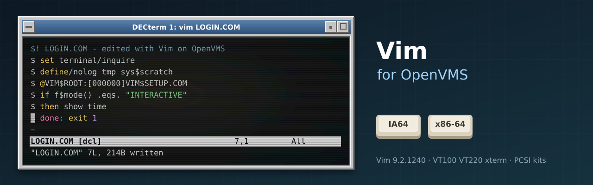

<p align="center">
  
</p>

# vms-vim

Vim 9.2, the editor, for OpenVMS (IA64 and x86-64), built natively with VSI C from
upstream's signed release tags, with a PCSI kit.

Upstream Vim keeps its VMS support (src/os_vms*.c, src/Make_vms.mms). This port builds
upstream as it stands, follows its releases, and adds what upstream does not ship: a
verified source, a repeatable build on both architectures, tests, and an installer. The
existing binaries at [polarhome.com/vim](http://www.polarhome.com/vim/) are zip files of
executables, with no installer, and lag upstream.

The repository stores only our changes over the upstream tag:
- `patches/` holds changes to upstream files, applied in `patches/series` order.
- `overlay/` holds new files: VMS build procedures and the PCSI kit.

`tools/prepare.sh` combines them with the tag into `staging/`, which is pushed to a VMS
node and built there with MMS. The tooling is shared with the other ports in the family;
see [vms-grep](https://github.com/issinoho/vms-grep) for the list.

## Installing

Kits are on the [releases page](https://github.com/issinoho/vms-vim/releases). A kit
downloaded through a non-VMS system loses its record format; restore it, then install:

```
$ SET FILE/ATTRIBUTE=(RFM:FIX,LRL:8192,MRS:8192,RAT:NONE) ISSINOHO-*-VIM-V0902-1240E1-1.PCSI
$ PRODUCT INSTALL VIM /PRODUCER=ISSINOHO /SOURCE=dev:[dir]
```

The install takes a few minutes (17 on a small IA64): the runtime is about 5,400 files,
which the kit then gives their real lower-case names. Then, as the kit says:

```
$ @SYS$STARTUP:VIM$STARTUP.COM               ! in SYS$MANAGER:SYSTARTUP_VMS.COM
$ @VIM$ROOT:[000000]VIM$SETUP.COM            ! in LOGIN.COM or SYLOGIN.COM
```

`PRODUCT REMOVE VIM` removes it all.

## Using it

```
$ vim LOGIN.COM
$ view SYS$MANAGER:SYSTARTUP_VMS.COM          ! read-only
$ vimdiff NOTES.TXT;1 NOTES.TXT;2
$ pipe directory | vim -
$ vimtutor                                    ! or: vimtutor de
```

- **Files:** Vim writes a new version, as other VMS editors do. Variable-length, VFC and
  stream files all edit (VFC is written back as variable-length). VMS and Unix names both
  work: `[.sub]file.txt` and `sub/file.txt`.
- **Settings:** `SYS$LOGIN:.vimrc` (made with EDIT is fine); site-wide ones in
  `VIM$ROOT:[000000]vimrc`, which the kit does not ship, so an upgrade never replaces it.
- **Terminals:** VT100, VT200-VT500, DECterm, and xterm-style emulators over ssh; the size
  follows SET TERMINAL/WIDTH and /PAGE. `:!command` runs DCL; CTRL/C interrupts a search,
  a script or `:sleep`.
- **Options:** `-x` is read as `-x` and `-/x` as `-X` with either DCL parse style; with
  `SET PROCESS/PARSE_STYLE=EXTENDED` a quoted option keeps its case (`"-R"`).
- **Scripts:** `vim -es` runs Ex commands from a file or a pipe (`PIPE`, `DEFINE/USER
  SYS$INPUT`), and `:cq` gives DCL an error status.

**Known limits:** terminal Vim only (no gvim, `:terminal`, jobs or channels; no Perl,
Python, Lua or Ruby). Plugins that run Unix commands need them. Two runtime files whose
names PCSI cannot hold (Chinese GB and Big5 menu translations) are not in the kit.

## Status

Released as v9.2.1240-vms2. See [docs/PLAN.md](docs/PLAN.md) for the phases and
[docs/NOTES.md](docs/NOTES.md) for what was found on the way.

| Step | IA64 (V8.4-2L3) | x86-64 (E9.2-4) |
|------|-----------------|-----------------|
| Build with upstream's Make_vms.mms + patches 0001-0010 (`tools/build.sh`) | clean, no warnings | clean, no warnings |
| DCL smoke test, 29 checks (`tools/test.sh`) | 29/29 | 29/29 |
| PCSI kit `ISSINOHO <base> VIM V9.2-1240E1` (`tools/kit.sh`) | built (52 MB) | built (49 MB) |
| Install check (`tools/installcheck.sh`): install, smoke 27/27, clean removal | pass (17 min) | pass (5 min) |
| Interactive test, 20 checks (`tools/ttytest.sh`) | 20/20 | 20/20 |
| Upstream's own tests, 37-file sample (`tools/vimtests.sh`) | | 1254 run, 89 % pass |

## Workflow

```sh
cp tools/nodes.conf.example tools/nodes.conf   # then fill in the real nodes
tools/prepare.sh                               # fetch and verify the tag, patch, stage
tools/build.sh <node>                          # push and build with MMS
tools/push.sh <node> runtime                   # once: the runtime files, for the tests
tools/test.sh <node>                           # smoke test (non-interactive, on VMS)
tools/ttytest.sh <node>                        # interactive test from the host (pexpect, pyte)
tools/vimtests.sh <node> join,sort,...         # upstream's tests (push.sh <node> testdir first)
tools/kit.sh <node>                            # PCSI kit -> out/kits/ (producer ISSINOHO)
tools/installcheck.sh <node>                   # install, verify, remove (changes the system)
```

## What the port changes

| Change | Why |
|---|---|
| `0001-vms-mch-calc-cell-size` | Upstream 9.2 calls mch_calc_cell_size(), which VMS lacked: VIM.EXE did not link ([N2](docs/NOTES.md)) |
| `0002-termlib-strncpy-casts` | The only compiler warnings in the VMS build ([N3](docs/NOTES.md)) |
| `0003-vms-read-non-terminal-input` | Input from a file or mailbox: Vim looped for ever ([N4](docs/NOTES.md)) |
| `0004-vms-fopen-record-files` | `:source`, readfile(), system() on VAR/VFC files ran the lines together ([N5](docs/NOTES.md)) |
| `0005-vms-settmode-sleep-deccolm` | `:!cmd` output wiped by DECCOLM; CTRL-C while sleeping ([N7](docs/NOTES.md)) |
| `0006-vms-breakcheck-tmode` | CTRL-C interrupted nothing ([N8](docs/NOTES.md)) |
| `0007-vms-getenv-no-symbols` | `$VIM` was the DCL symbol `vim` (the command itself) ([N10](docs/NOTES.md)) |
| `0008-vms-shellsize-unknown` | With output to a file the screen was 12x2 ([N12](docs/NOTES.md)) |
| `0009-vms-mkdir-p-isdir` | `mkdir(d, 'p')` looped; isdirectory() of `dir]/sub` ([N14](docs/NOTES.md)) |
| `0010-vms-rename-case-only` | rename() that changed only the case left the file as `123.VIM` ([N17](docs/NOTES.md)) |
| `vms/build.com` | Runs upstream's Make_vms.mms for VIM.EXE and XXD.EXE |
| `vms/test_smoke.com`, `tools/ttytest.py` | Smoke test (DCL, `vim -es`) and interactive test (pexpect + pyte over ssh) |

## License

Vim is Charityware under the [Vim License](https://github.com/vim/vim/blob/master/LICENSE)
(shipped in the kit as `[VIM.DOC]LICENSE.`). The patches and VMS files here are offered
under the same license, and the patches are meant for upstream.
